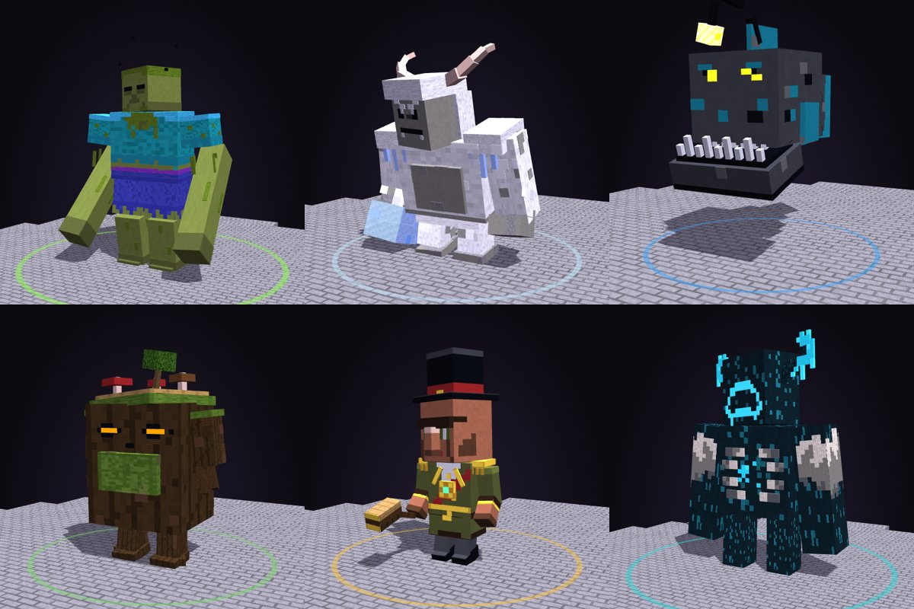
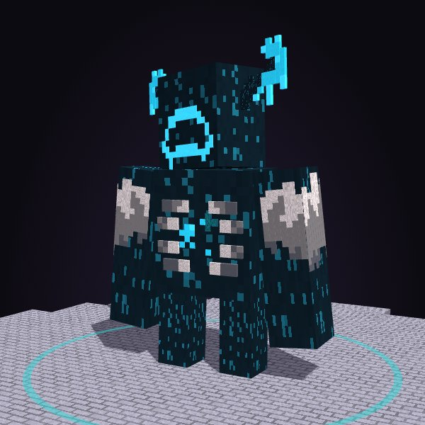
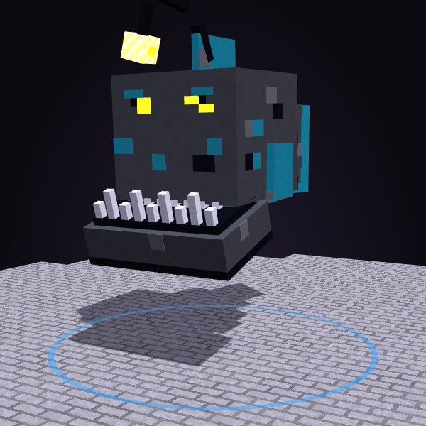
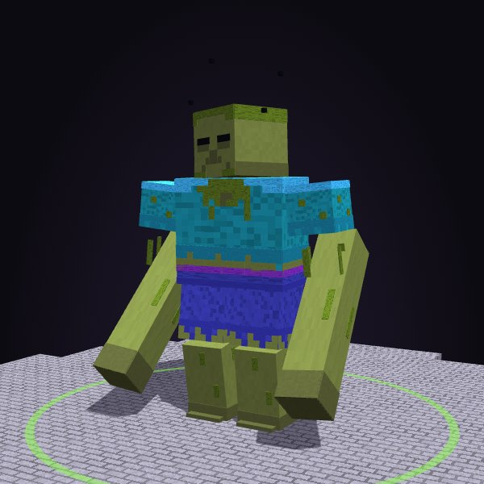
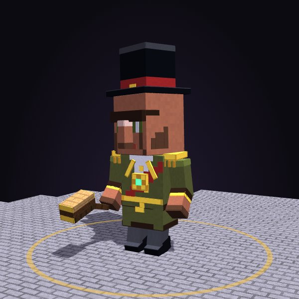
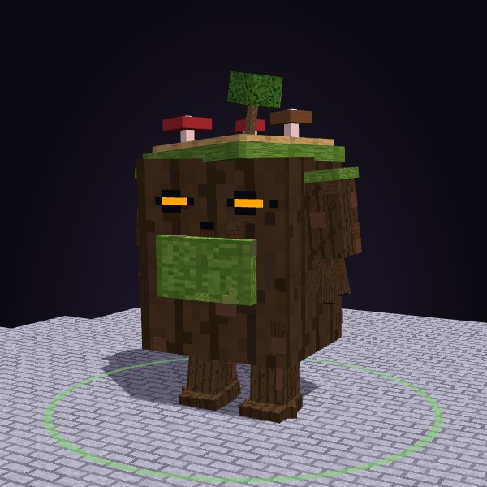
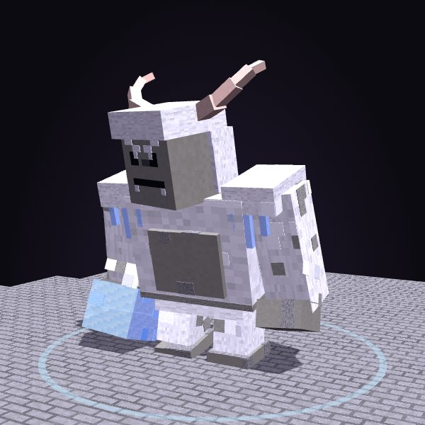

# CBosses

<p align="center"></p>

**CBosses** adds 93 animated block-model bosses to Paper and Folia servers. Every boss is built from 33 to
300 display blocks, has its own entrance, its own attacks and its own death, and runs on a schedule, on a
season, right after a player finishes a CQuests chapter, or as the finale once both legends have fallen. It
works on its own and alongside **CQuests**, and it has full **WorldGuard** support.

### [Open the 3D boss viewer](https://claude.ai/artifact/NbYXjJCKyRwZ2oTmETby7k)

Spin every boss around, play its entrance, each attack and its death, right in your browser. A copy of the viewer is
also in this repo at [`docs/viewer.html`](docs/viewer.html) (download and open it locally).

## Highlights

- **Hand-built models.** Every big boss is 150 blocks or more, and every block is there for a reason: faces painted
  pixel by pixel, armour with rims and rivets, torn hems, fur tufts, glowing cracks that follow the plates, and props
  that tell you who the boss is. Chapter bosses are smaller and simpler on purpose. Turn the fine detail down with
  `effects.model-detail` on a busy server.
- **A different entrance for every boss.** No two are the same: the Grand Augur's crown floats down onto his head last,
  Killer Claus climbs out of his own sack, Frostbottom stacks himself one snowball at a time, the Vault Mimic is just a
  chest until it stands up, and Clucksworth hatches out of a painted Easter egg.
- **A different death for every boss.** Each death has a flash and its own story: the Horseman's pumpkin is thrown, the
  Pharaoh pours away as sand, Fenrir freezes and shatters, the Void Walker is sucked into a point and bursts.
- **The finale.** Beat the Withered Tyrant and The Listener Below and **The Unmaker**
  wakes: a ten block tall, four-armed titan with a void heart, one great eye and a crown of orbiting shards.
- **Private chapter bosses.** A chapter boss appears where the player finished their quest and only exists for them:
  nobody else sees it, hears it, bumps into it or gets attacked. No boss ever breaks or places blocks.
- **Every word is yours.** All chat lines, titles, action bars, menus and the defeat broadcast are in `messages.yml`;
  boss names, titles and descriptions are in `bosses.yml`.
- **Attacks you can read.** Every ability has its own wind-up pose, effects and impact: slams, charges, dives, beams, meteors,
  spikes, sonic booms, minion waves and more. Flying bosses swoop and dive instead of jumping.
- **Chapter bosses.** A small, simple boss after most CQuests chapters (ops can put any boss on any chapter), each built for its chapter's story.
- **Legend bosses.** The Listener Below (the Warden) and the Withered Tyrant (the Wither) are the biggest
  fights in the plugin.
- **Seasonal bosses.** Three each for Halloween, Winter, Easter and Summer, including Killer Claus, Brain Freeze,
  Clucksworth and the Headless Horseman.
- **25 world bosses.** From the Grand Augur and the Crimson Oni to King Gloop, the slime king.
- **Built to stay light.** Models only update near players, movement uses client-side interpolation, particles and flying
  blocks have hard caps, and every cost can be tuned in `effects:`. Region schedulers make it Folia-safe.
- **Tested on real servers.** CI starts Paper 1.21.4, Paper 26.x and Folia, spawns every boss, runs each attack and plays
  each death, and fails on any error.

## Chapter bosses

When a player finishes a chapter in CQuests, CBosses counts down on their screen and their chapter boss appears in a
circle at their quest spot. It is their own private fight: other players do not see it, hear it or get hit by it,
and its minions only go after that player. If they lose or leave, it waits for `/cbosses chapter retry`. Pick a different boss per chapter under `chapter-bosses.bosses` in `config.yml`.

| Chapter | Boss | Health | Blocks |
|---|---|---|---|
| 1 | Brakka the Torchbearer | 3000 | 133 |
| 2 | Grimsby | 3000 | 100 |
| 3 | Sir Oakheart | 3000 | 152 |
| 4 | The Gnome Brothers | 3000 | 185 |
| 5 | Old Moss | 3000 | 300 |
| 7 | Grub | 3000 | 297 |
| 9 | Mudd | 3000 | 248 |
| 10 | Ugor | 3000 | 165 |

<table>
<tr><td valign="top" width="33%"><br><b>Brakka the Torchbearer</b><br><i>Burner of the Wanderers' Camp</i><br><sub><code>brakka</code> · 3000 HP · 2 phases · Walks</sub><br><br>Chapter 1, The Wanderers' Camp: Brakka the bandit chief. A burly raider with a red bandana over his face, an eye patch, leather armour with a wolf-fur collar, a satchel of stolen loot, a crossbow slung on his back and a hatchet in each hand.<br><br><sub><b>Attacks:</b> Volley, Charge, Minions, Slam, Fire Ring</sub></td><td valign="top" width="33%"><br><b>Grimsby</b><br><i>Nothing Passes Without the Key</i><br><sub><code>gate_shade</code> · 3000 HP · 2 phases · Hovers</sub><br><br>Grimsby, the gate gargoyle: a crouching stone gargoyle that hovers on slow beats of its bat wings, mossy on the shoulders, with curled horns, a heavy brow over glowing soul-blue eyes, a wide fanged grin and pointed ears. It hugs a huge iron key to its chest with clawed hands, its legs are tucked up under it, and a long tail with a spade tip hangs below.<br><br><sub><b>Attacks:</b> Blink, Darkness, Minions</sub></td><td valign="top" width="33%"><br><b>Sir Oakheart</b><br><i>The Elder's Champion</i><br><sub><code>oakheart</code> · 3000 HP · 2 phases · Walks</sub><br><br>Chapter 3, The Elder's Charge: an old oak that woke up to protect the elder's grove. A trunk of bark with a hollow full of amber light for a face, mossy shoulders, branch arms that end in leafy fists, roots for feet, mushrooms on its side and a bird's nest in its crown of leaves.<br><br><sub><b>Attacks:</b> Quake, Minions, Spikes, Volley, Heal</sub></td></tr>
<tr><td valign="top" width="33%"><br><b>The Gnome Brothers</b><br><i>Bramble and Thimble</i><br><sub><code>gnome_brothers</code> · 3000 HP · 2 phases · Walks</sub><br><br>The Gnome Brothers, from the gnome-and-mini-gnome picture: Bramble in a huge leaning green hat and a red coat, and his little brother Thimble at his side in a tall dark red hat and a green coat. Both have big peach noses and long checked white beards. The hats sway and Thimble hops about.<br><br><sub><b>Attacks:</b> Minions, Leap, Slam</sub></td><td valign="top" width="33%"><br><b>Old Moss</b><br><i>Two Faces in the Stone</i><br><sub><code>moss_spirit</code> · 3000 HP · 2 phases · Walks</sub><br><br>Picture 2: a squat stone spirit with two faces, glowing blue eyes on its head and a second pair on its chest, moss and grass growing over its shoulders with a white flower, and a gnarled wooden staff wound with moss, set with a red crystal.<br><br><sub><b>Attacks:</b> Heal, Pull, Slam, Shockwave</sub></td><td valign="top" width="33%"><br><b>Grub</b><br><i>The Bridge Troll</i><br><sub><code>grubnose</code> · 3000 HP · 2 phases · Walks</sub><br><br>Grub the troll, sculpted: a hunched ochre troll that is all shoulders and long arms, the head hung low and forward under a hump of muscle, a heavy brow over small black eyes, a huge bulbous red nose over a lipless grin with stubby tusks, long drooping ears, rag wraps round thick forearms and big fists, short bowed legs with splayed toes, and a leather loincloth on a belt strung with bones and a little skull.<br><br><sub><b>Attacks:</b> Slam, Shockwave, Charge</sub></td></tr>
<tr><td valign="top" width="33%"><br><b>Mudd</b><br><i>The River Troll</i><br><sub><code>mudclub</code> · 3000 HP · 2 phases · Walks</sub><br><br>Mudd the bog ogre, sculpted: a broad dark green brute with two curved pale horns sweeping out of its brow, a scowl over red eyes, a wide grin full of square teeth over a black goatee, a chest that tapers to a hard gut, a ragged brown loincloth, iron bands on its wrists and a heavy knotted log club studded with iron.<br><br><sub><b>Attacks:</b> Slam, Leap, Shockwave</sub></td><td valign="top" width="33%"><br><b>Ugor</b><br><i>The Last Brute</i><br><sub><code>ugor</code> · 3000 HP · 2 phases · Walks</sub><br><br>Ugor, the last brute: a huge hunched boar-man in coarse brown fur with a dark mane from his crown down his back, a big pink snout, small mean eyes under a heavy black brow, two curved ivory tusks, floppy ears, a studded belt with a skull buckle over a ragged leather loincloth, a necklace of teeth, long arms with leather-wrapped forearms and huge fists, and black hooves.<br><br><sub><b>Attacks:</b> Minions, Charge, Quake, Slam</sub></td></tr>
</table>


## The finale

When the Withered Tyrant and The Listener Below have all been beaten (in any order, by anyone),
the whole server is warned and The Unmaker wakes at the main arena a minute later. `/cbosses finale` shows how far
the server is, `/cbosses finale wake` starts it now and `/cbosses finale reset` starts over. Change the bosses, the
delay and the arena under `finale:` in `config.yml`.

<table>
<tr><td valign="top" width="33%"><br><b>THE UNMAKER</b><br><i>Heart of the Void</i><br><sub><code>the_unmaker</code> · 3000 HP · 5 phases · Hovers</sub><br><br>The finale. Wakes once the Withered Tyrant and The Listener Below have all been beaten. A floating titan of obsidian armoured in end-stone plates trimmed in gold. One great eye with a purple iris; a crown of eight shards turning over its head; a void heart in a diamond-shaped opening in its chest; four arms: two huge gauntleted fists above, a void blade and an end-crystal orb below; two blade fins on its back; no legs, its body ends in a trailing tail of stone plates over a rune circle on the ground.<br><br><sub><b>Attacks:</b> Slam, Charge, Orbs, Meteor, Quake, Sonic Boom, Pull, Darkness, Lightning, Blink, Minions</sub></td></tr>
</table>


<p align="center"><sub>The void heart lights alone in the air, the four arms swing in, and the end: the arms torn away before it bursts.</sub></p>

## Legend bosses

<table>
<tr><td valign="top" width="33%"><br><b>THE LISTENER BELOW</b><br><i>It Hears Your Heartbeat</i><br><sub><code>the_listener</code> · 3000 HP · 4 phases · Walks</sub><br><br>The warden of the deep dark grown into a legend: a towering dark-teal brute with no eyes, a wide jaw full of bone teeth, two great sensor horns that glow at the tips, an open ribcage where souls burn in a pulsing heart, sculk spreading over its shoulders and back, and long arms ending in clawed fists laced with glowing veins. It finds you by sound.<br><br><sub><b>Attacks:</b> Sonic Boom, Slam, Quake, Darkness, Shockwave, Pull, Charge</sub></td><td valign="top" width="33%"><br><b>The Withered Tyrant</b><br><i>Three Skulls, One Hunger</i><br><sub><code>withered_tyrant</code> · 3000 HP · 3 phases · Hovers</sub><br><br>The Wither grown into a tyrant: three skulls on a bar of blackstone set with bone spikes, the middle one crowned in netherite and soul gems, a ribcage of dark bone with soul fire burning inside, a long spine that curls into a tail of flame, tattered black banners hanging from the bar and wither skulls circling it like moons.<br><br><sub><b>Attacks:</b> Skulls, Minions, Charge, Shockwave, Darkness, Meteor, Dive</sub></td></tr>
</table>


## World bosses

These take turns as the weekly public boss at your arena.

<table>
<tr><td valign="top" width="33%"><br><b>Magmus</b><br><i>The Lava Golem</i><br><sub><code>slagheart</code> · 3000 HP · 2 phases · Walks</sub><br><br>A hunched stone colossus with one oversized fist. Its body is a molten core held in by grey stone plates; the gaps between the plates glow, so the cracks follow the armour instead of being random.<br><br><sub><b>Attacks:</b> Slam, Quake, Meteor, Charge, Fire Ring, Shockwave</sub></td><td valign="top" width="33%"><br><b>Warlord Gruk</b><br><i>Piglin Boss of the Bastion</i><br><sub><code>warlord_gruk</code> · 3000 HP · 3 phases · Walks</sub><br><br>A pot-bellied piglin warlord: gold half helm with iron horns, a buckled war belt over a ragged green kilt, gold pauldrons, studded bracers and a stone maul bound with iron.<br><br><sub><b>Attacks:</b> Slam, Charge, Minions, Quake, Leap, Shockwave</sub></td><td valign="top" width="33%"><br><b>King Malrick</b><br><i>Ruler of the Illagers</i><br><sub><code>grand_augur</code> · 3000 HP · 2 phases · Walks</sub><br><br>The illager arch-sorcerer of ref38: a huge grey illager head with a hard black unibrow and a long nose, a tall open gold crown with a red and a blue gem, a blue coat with gold trim over a dark green tunic, a ruby amulet, big square gold cuffs, red pointed shoes, and a grey staff banded in red with a glowing gold crystal floating at its tip.<br><br><sub><b>Attacks:</b> Orbs, Volley, Minions, Blink, Slam, Levitate, Darkness</sub></td></tr>
<tr><td valign="top" width="33%"><br><b>Akuma</b><br><i>The Red Oni</i><br><sub><code>crimson_ronin</code> · 3000 HP · 2 phases · Walks</sub><br><br>A red oni warlord: a snarling face framed by a white mane and two ivory horns, a gold rope of beads, a white loincloth with a black tooth pattern, gold-trimmed armour skirt and a huge studded iron club.<br><br><sub><b>Attacks:</b> Slam, Charge, Quake, Roar, Leap, Fire Ring</sub></td><td valign="top" width="33%"><br><b>Big Bongo</b><br><i>The Storm Gorilla</i><br><sub><code>thunderback</code> · 3000 HP · 2 phases · Walks</sub><br><br>Big Bongo, the storm gorilla, sculpted: a huge silverback that leans on its knuckles, a peaked skull hung low between a wall of shoulders, a heavy brow over glowing storm-blue eyes, a wide flat nose and a fanged scowl, a bare dark chest, gold rings with a lightning mark on its arms, and a chieftain's band of four coloured feathers.<br><br><sub><b>Attacks:</b> Slam, Quake, Lightning, Charge, Leap, Shockwave</sub></td><td valign="top" width="33%"><br><b>Gorehorn</b><br><i>Minotaur of the Pit</i><br><sub><code>gorehorn</code> · 3000 HP · 2 phases · Walks</sub><br><br>Gorehorn, champion of the fighting pit, sculpted: a huge minotaur with a dark bull head on a thick neck, a long pale muzzle with a gold nose ring, red eyes under a heavy brow and two long pale horns that sweep out and forward; a white mane over his shoulders like a cape, crossed leather straps meeting at an iron boss, a studded belt with a blue loincloth, shaggy bull legs on black hooves, and a double axe.<br><br><sub><b>Attacks:</b> Charge, Slam, Quake, Roar, Shockwave, Leap</sub></td></tr>
<tr><td valign="top" width="33%"><br><b>Mama Gulp</b><br><i>The Deep Sea Angler</i><br><sub><code>abyssal_eye</code> · 3000 HP · 2 phases · Hovers</sub><br><br>A deep sea anglerfish swimming through the air: a huge dark round head with a jutting underbite full of needle teeth, small glowing yellow eyes, a glowing lure on a stalk that bends over its face, side fins that paddle and a tail that sweeps from side to side.<br><br><sub><b>Attacks:</b> Frost, Pull, Charge</sub></td><td valign="top" width="33%"><br><b>Rusty</b><br><i>The Jungle Golem</i><br><sub><code>overgrowth</code> · 3000 HP · 2 phases · Walks</sub><br><br>A ruined terracotta guardian that the jungle took back: banded clay limbs made of stacked rings, moss on the shoulders, vines hanging down its chest and arms, one amber eye in a cracked head.<br><br><sub><b>Attacks:</b> Slam, Quake, Minions, Pull, Spikes, Poison</sub></td><td valign="top" width="33%"><br><b>Gemma</b><br><i>The Crystal Golem</i><br><sub><code>prism_sentinel</code> · 3000 HP · 2 phases · Walks</sub><br><br>A crystal golem cut from diamond and amethyst: faceted plates over a glowing cyan core, a gem set in its chest, crystal clusters growing from the shoulders and a visor slit for eyes.<br><br><sub><b>Attacks:</b> Slam, Sonic Boom, Volley, Heal, Orbs, Shockwave</sub></td></tr>
<tr><td valign="top" width="33%"><br><b>Big Tiki</b><br><i>Idol of the Island</i><br><sub><code>tiki_warden</code> · 3000 HP · 2 phases · Walks</sub><br><br>A volcanic tiki idol come to life: a huge carved mask for a head with a lit mouth, orange stone body cut with glyph bands, a feathered headdress and a jagged obsidian-edged war blade.<br><br><sub><b>Attacks:</b> Meteor, Slam, Charge, Quake, Fire Ring, Shockwave</sub></td><td valign="top" width="33%"><br><b>Widow Mae</b><br><i>Queen of the Spiders</i><br><sub><code>broodmother</code> · 3000 HP · 3 phases · Walks</sub><br><br>The spider queen: a black, hairy body banded in venom green, a swollen abdomen marked with a red hourglass, eight glowing eyes in two rows, long jointed legs and dripping fangs.<br><br><sub><b>Attacks:</b> Minions, Leap, Pull, Poison, Charge, Spikes</sub></td><td valign="top" width="33%"><br><b>King Crabby</b><br><i>Ruler of the Reef</i><br><sub><code>tide_tyrant</code> · 3000 HP · 3 phases · Walks</sub><br><br>A giant red crab king: a wide speckled shell crusted with barnacles and a crown of pink and yellow coral, eyes on stalks that twitch, one huge crusher claw and one quick little claw, and six pointed legs that tap while it waits.<br><br><sub><b>Attacks:</b> Frost, Minions, Slam</sub></td></tr>
<tr><td valign="top" width="33%"><br><b>Bjorn</b><br><i>The Storm Ram</i><br><sub><code>storm_herald</code> · 3000 HP · 3 phases · Walks</sub><br><br>Bjorn, the Storm Ram: a towering ram-man in thick white wool with grey patches, a long dark grey face with a pale muzzle and a wool goatee, glowing yellow eyes with slit pupils, two huge cream horns that curl back and round past his ears, a storm cloud riding his shoulders with lit bolts hanging from it, copper bracers on dark forearms, a forked copper rod in his fist and black hooves.<br><br><sub><b>Attacks:</b> Lightning, Charge, Shockwave, Slam</sub></td><td valign="top" width="33%"><br><b>Pharaoh Ankhamun</b><br><i>Back From the Tomb</i><br><sub><code>pharaoh</code> · 3000 HP · 3 phases · Walks</sub><br><br>A mummy pharaoh: linen-wrapped limbs with loose strips, a striped gold and lapis headdress with a cobra crest, a broad jewelled collar, a gold mask over one half of the face and a crook staff.<br><br><sub><b>Attacks:</b> Minions, Blink, Darkness, Spikes, Poison, Orbs</sub></td><td valign="top" width="33%"><br><b>The Executioner</b><br><i>Axe of the Mansion</i><br><sub><code>executioner</code> · 3000 HP · 3 phases · Walks</sub><br><br>A giant headsman: a black hood with a single eye slit, a bare grey chest crossed with chains, a blood-red apron over leather, iron manacles on its wrists and a huge crescent axe.<br><br><sub><b>Attacks:</b> Slam, Charge, Quake, Pull, Minions, Shockwave</sub></td></tr>
<tr><td valign="top" width="33%"><br><b>Big Bertha</b><br><i>The Living Furnace</i><br><sub><code>ember_queen</code> · 3000 HP · 3 phases · Hovers</sub><br><br>The Forge Mother: a broad smith giantess with soot-dark skin, two thick copper braids bound with gold rings, a scorched leather apron over a furnace in her belly that glows through an iron grate, rolled sleeves, heavy black gloves, iron boots and a huge forge hammer with a glowing hot face.<br><br><sub><b>Attacks:</b> Fire Ring, Meteor, Slam</sub></td><td valign="top" width="33%"><br><b>Mister Bones</b><br><i>The Gravedigger</i><br><sub><code>gravelord</code> · 3000 HP · 3 phases · Walks</sub><br><br>Mister Bones, the gravedigger: a big chunky skeleton in a tall battered top hat with a purple band and a long black coat hanging open over his ribs. Soul-blue lights burn in his eye sockets above a toothy grin. He has bony hands and knees, worn boots, a soul lantern on his belt, and digs with a huge iron shovel.<br><br><sub><b>Attacks:</b> Skulls, Pull, Minions</sub></td><td valign="top" width="33%"><br><b>Captain Brine</b><br><i>Captain of the Drowned</i><br><sub><code>captain_brine</code> · 3000 HP · 2 phases · Walks</sub><br><br>A ghost pirate captain: a big tricorn hat with a skull badge, a red coat with gold buttons and cuffs, a peg leg, a hook hand, a cutlass and a green ghostly glow coming off him.<br><br><sub><b>Attacks:</b> Minions, Charge, Pull, Meteor, Shockwave, Frost</sub></td></tr>
<tr><td valign="top" width="33%"><br><b>Old Jangles</b><br><i>Keeper of the Five Keys</i><br><sub><code>keywarden</code> · 3000 HP · 2 phases · Walks</sub><br><br>Old Jangles, Keeper of the Five Keys: a stout clockwork vault guardian. A brass boiler body in copper bands with rivets, a lock plate with a glowing keyhole and a pressure gauge, two smokestacks on its back, a brass head with two glowing amber lenses, a grille mouth and a glass dome with a lit gear inside, piston arms with brass gauntlets, a round lock shield, a ring of five keys jangling at its belt and a big wind-up key turning in its back.<br><br><sub><b>Attacks:</b> Slam, Charge, Minions, Darkness, Shockwave, Orbs</sub></td><td valign="top" width="33%"><br><b>Hamhock</b><br><i>The War Boar</i><br><sub><code>bloodtusk</code> · 3000 HP · 3 phases · Walks</sub><br><br>Old Tusker, the war boar of the red banner: a great bristly boar in dark brown with a black ridge of stiff hair down its back, a broad pink snout, two huge curved tusks, little angry eyes, red war paint stripes, an iron plate saddle strapped over its back and a tall red banner on a pole that flaps above it.<br><br><sub><b>Attacks:</b> Charge, Minions, Shockwave</sub></td><td valign="top" width="33%"><br><b>King Gloop</b><br><i>King of the Swamp</i><br><sub><code>king_gloop</code> · 3000 HP · 3 phases · Walks</sub><br><br>King Gloop with extra detail: bubbles rising inside the jelly, a ring of slimeballs round his crown and swallowed loot floating in his body.<br><br><sub><b>Attacks:</b> Leap, Quake, Minions, Poison, Spikes, Shockwave</sub></td></tr>
<tr><td valign="top" width="33%"><br><b>Tick-Tock</b><br><i>The Clockwork Giant</i><br><sub><code>clockwork_colossus</code> · 3000 HP · 2 phases · Walks</sub><br><br>The Clockwork Colossus: a riveted copper and iron giant wound up by a great gold key turning in its back. Its chest is a round glass window onto a turning gold gear with a glowing core; its eyes are two lit slits in a domed iron helm with a steam whistle on top, twin exhaust stacks puff behind its shoulders, and its arms are iron pistons that end in heavy riveted fists.<br><br><sub><b>Attacks:</b> Slam, Charge, Blink, Darkness</sub></td><td valign="top" width="33%"><br><b>Boulder</b><br><i>The Walking Hill</i><br><sub><code>mossback</code> · 3000 HP · 2 phases · Walks</sub><br><br>Mossback trimmed to about 250 blocks: the smallest loose bits go first, the head and glowing parts stay.<br><br><sub><b>Attacks:</b> Slam, Quake, Blink, Shockwave</sub></td><td valign="top" width="33%"><br><b>Wizard Aldo</b><br><i>Older Than the Mountains</i><br><sub><code>old_wizard</code> · 3000 HP · 2 phases · Walks</sub><br><br>An old wizard in a tall purple hat with a brown band and a gold buckle, the tip bent over. Bushy white brows hide his eyes, a big nose sits over a long white beard, his purple robe is belted, he leans on a crooked staff topped with a glowing crystal and holds a heavy open spell book.<br><br><sub><b>Attacks:</b> Blink, Slam, Orbs, Minions</sub></td></tr>
<tr><td valign="top" width="33%"><br><b>Hollow Hank</b><br><i>Nothing Under the Hat</i><br><sub><code>hollow_mage</code> · 3000 HP · 2 phases · Walks</sub><br><br>The Hollow Mage: a round little wizard in a huge mustard hat with a green band, the tall crown slumped over to one side. Under the brim there is only dark and two glowing yellow eyes. A blue coat with a tall collar, crossed straps and a buckle, white sleeves with green cuffs, striped green trousers and a crook staff.<br><br><sub><b>Attacks:</b> Blink, Slam, Orbs, Fire Ring</sub></td><td valign="top" width="33%"><br><b>Gorrak</b><br><i>Brute of the Mountain Pass</i><br><sub><code>horned_brute</code> · 3000 HP · 2 phases · Walks</sub><br><br>A squat mountain brute: a huge boxy tan body with mottled hide, a heavy head with thick dark brows, a long striped snout, two stubby white tusks and great curled black horns. Long arms hang to the ground, a ragged hide loincloth hangs in strips and he drags an iron-headed spear.<br><br><sub><b>Attacks:</b> Slam, Charge, Roar, Shockwave, Quake</sub></td><td valign="top" width="33%"><br><b>Big Gus</b><br><i>Too Big to Stay Buried</i><br><sub><code>rotting_giant</code> · 3000 HP · 2 phases · Walks</sub><br><br>A towering rotting giant: a small green head with sunken black eyes on a broad body, a torn cyan shirt stained with moss and rot, ragged purple trousers torn off at the knee, and long gangly green arms and legs. Flies and a rot cloud hang round him.<br><br><sub><b>Attacks:</b> Slam, Charge, Roar, Quake, Shockwave</sub></td></tr>
<tr><td valign="top" width="33%"><br><b>Stinger</b><br><i>The Desert Scorpion</i><br><sub><code>dusk_scorpion</code> · 3000 HP · 2 phases · Walks</sub><br><br>A giant slate-purple scorpion: a long plated body with glowing red eye clusters, two heavy pincers held forward, ragged fins along its sides, eight thin legs, and a segmented tail that arches right over its back to a blocky stinger.<br><br><sub><b>Attacks:</b> Charge, Slam, Poison</sub></td><td valign="top" width="33%"><br><b>Marshal Graves</b><br><i>Keeps the Dead in Line</i><br><sub><code>grave_marshal</code> · 3000 HP · 2 phases · Walks</sub><br><br>A skeleton general from a lost war: the vanilla skeleton's skull and ribs inside dark purple plate, with huge frayed pauldrons, armoured boots and bracers, a stone war hammer in its right hand and a tower shield on its left arm with the arrows of its last battle still stuck in it.<br><br><sub><b>Attacks:</b> Slam, Charge, Volley, Shockwave</sub></td><td valign="top" width="33%"><br><b>Mayor Grumble</b><br><i>Taxes Are Due</i><br><sub><code>mayor_grumble</code> · 3000 HP · 2 phases · Walks</sub><br><br>Mayor Grumble, the village mayor as a person: the long villager head with its big nose, one thick unibrow over green eyes and a grumpy frown, a tall black top hat with a red band, a green coat with gold buttons, a red sash, a gold chain of office with a big emerald, grey trousers and polished black shoes, and a heavy wooden gavel.<br><br><sub><b>Attacks:</b> Minions, Volley, Quake, Roar</sub></td></tr>
<tr><td valign="top" width="33%"><br><b>Grandpa Oak</b><br><i>The Oldest Tree</i><br><sub><code>old_ironroot</code> · 3000 HP · 2 phases · Walks</sub><br><br>A walking tree stump with ring-cut wood on top, mushrooms and a sapling growing out of its moss, glowing amber knot-hole eyes over a mossy beard, and arms and legs of thick twisting roots.<br><br><sub><b>Attacks:</b> Spikes, Heal, Minions</sub></td><td valign="top" width="33%"><br><b>Yuki</b><br><i>The Cave Yeti</i><br><sub><code>frost_yeti</code> · 3000 HP · 2 phases · Walks</sub><br><br>A huge shaggy white yeti hunched forward on long arms, thick fur in white and pale grey, a blue-grey face with a heavy brow, a wide mouth with two fangs, short curled horns, icicles hanging off its shoulders and a fist frozen into a block of ice.<br><br><sub><b>Attacks:</b> Frost, Slam, Shockwave, Volley</sub></td><td valign="top" width="33%"><br><b>Grok</b><br><i>The Swamp Bully</i><br><sub><code>bog_orc</code> · 3000 HP · 2 phases · Walks</sub><br><br>A huge pot-bellied swamp orc with mottled green skin, an iron helmet with two bull horns, an underbite with tusks, a fur pelt over one shoulder, swamp moss on its belt, rope-wrapped wrists and a spiked wooden club over its shoulder.<br><br><sub><b>Attacks:</b> Slam, Poison, Minions, Shockwave</sub></td></tr>
<tr><td valign="top" width="33%"><br><b>Brother Miller</b><br><i>Keeper of the Old Mill</i><br><sub><code>millstone_monk</code> · 3000 HP · 3 phases · Walks</sub><br><br>An ancient stone millkeeper with a carved cyan-eyed face, moss-covered shoulders, folded robes, heavy braced hands and an axle-mounted turning millstone. The exposed glowing axle is its weak spot.<br><br><sub><b>Attacks:</b> Shockwave, Quake, Heal</sub></td><td valign="top" width="33%"><br><b>Luna</b><br><i>The Moon Manta</i><br><sub><code>moonwake_manta</code> · 3000 HP · 3 phases · Flies</sub><br><br>A broad-winged nocturnal manta with layered prismarine fins, a dark belly, curled feeding horns, a luminous dorsal seam and a long articulated rudder tail.<br><br><sub><b>Attacks:</b> Pull, Volley, Levitate</sub></td><td valign="top" width="33%"><br><b>Viper</b><br><i>The Thorn Serpent</i><br><sub><code>thorncoil_basilisk</code> · 3000 HP · 3 phases · Walks</sub><br><br>A coiled root serpent with a raised cobra-like leaf hood, a long hinged jaw, inset golden side eyes, paired ivory fangs and connected bark-armoured body segments.<br><br><sub><b>Attacks:</b> Poison, Roar, Quake</sub></td></tr>
<tr><td valign="top" width="33%"><br><b>Big Root</b><br><i>The Giant Mandrake</i><br><sub><code>rootmaw</code> · 3000 HP · 2 phases · Walks</sub><br><br>Rootmaw, a mandrake root the size of a hut: a square trunk of pale knotted wood with a cracked crown, two glowing yellow eyes under a heavy brow, a huge mouth of jagged white teeth with a red gullet, two long root arms that split into twig fingers and drag on the ground, and a tuft of long yellow-green leaves that whip about on top.<br><br><sub><b>Attacks:</b> Slam, Spikes, Poison, Charge</sub></td><td valign="top" width="33%"><br><b>Smoky Hank</b><br><i>His Hat Is Still Burning</i><br><sub><code>cinder_hollow</code> · 3000 HP · 2 phases · Walks</sub><br><br>The Cinder Hollow, the hollow mage who tried fire magic once too often: a charred nether-brick hat with a glowing orange band, a red coat, orange eyes in the dark and a staff that ends in a burning ember.<br><br><sub><b>Attacks:</b> Blink, Slam, Orbs, Fire Ring, Meteor</sub></td><td valign="top" width="33%"><br><b>Chilly Hank</b><br><i>Snow on His Hat</i><br><sub><code>rime_hollow</code> · 3000 HP · 2 phases · Walks</sub><br><br>The Rime Hollow, the hollow mage from the far north: a hat of packed snow with an ice band, a cyan coat, pale blue eyes in the dark and a birch crook tipped with a shard of ice.<br><br><sub><b>Attacks:</b> Blink, Slam, Orbs, Fire Ring, Frost, Levitate</sub></td></tr>
<tr><td valign="top" width="33%"><br><b>Mossy Hank</b><br><i>Mushrooms on His Hat</i><br><sub><code>bramble_hollow</code> · 3000 HP · 2 phases · Walks</sub><br><br>The Bramble Hollow, the hollow mage who fell asleep in the woods for a hundred years: a spruce hat with red toadstools growing on the brim, a mossy green coat, lime eyes in the dark and a crook staff gone to moss.<br><br><sub><b>Attacks:</b> Blink, Slam, Orbs, Fire Ring, Poison, Spikes</sub></td><td valign="top" width="33%"><br><b>Bruno</b><br><i>The Tavern Ogre</i><br><sub><code>brewgut</code> · 3000 HP · 2 phases · Walks</sub><br><br>The tavern ogre, sculpted: a heavy round head sunk forward between hunched shoulders, a jutting underbite with two curved tusks, a thick brow over small deep eyes, a broad flat nose and pointed ears; a barrel belly in a grubby white shirt under an open leather vest, a thick belt with a brass buckle, a ragged apron, short thick legs in patched trousers and heavy boots, puffed sleeves, huge green forearms and fists, and a wooden tankard.<br><br><sub><b>Attacks:</b> Slam, Charge, Roar</sub></td><td valign="top" width="33%"><br><b>Coco</b><br><i>The Jungle Thief</i><br><sub><code>bark_ape</code> · 1000 HP · 2 phases · Walks</sub><br><br>The Bark Ape, a cheeky jungle thief: shaggy brown fur, a pale heart-shaped face with a wide muzzle, big round ears, long arms that hang to its knuckles, short bowed legs and a curled tail.<br><br><sub><b>Attacks:</b> Leap, Volley, Slam</sub></td></tr>
<tr><td valign="top" width="33%"><br><b>Hermit Ezra</b><br><i>He Hears Every Step</i><br><sub><code>old_blindman</code> · 1000 HP · 2 phases · Walks</sub><br><br>Hermit Ezra, sculpted: a stooped old man in a heavy brown hooded robe that flares to a ragged hem, the hood thrown forward so his face sits in shadow, eyes long gone under drooping white brows, a long hooked nose, a white beard that flows down to a rope belt, wide bell sleeves, a hump on his back, and a gnarled staff with a brass band whose crook carries a small lantern.<br><br><sub><b>Attacks:</b> Pull, Darkness, Slam</sub></td><td valign="top" width="33%"><br><b>King Albert</b><br><i>Ruler of One Village</i><br><sub><code>king_oldbeard</code> · 1000 HP · 2 phases · Walks</sub><br><br>King Oldbeard, an old villager king: the long villager head with its big nose, bushy white brows and a beard down to his belt, a gold crown with red gems, a red robe with a spotted white fur collar and trim, a gold belt, brown boots and a gold sceptre topped with a sun.<br><br><sub><b>Attacks:</b> Minions, Orbs, Slam</sub></td><td valign="top" width="33%"><br><b>Farmer Grimbly</b><br><i>Illager of the Wheat Field</i><br><sub><code>straw_farmer</code> · 1000 HP · 2 phases · Walks</sub><br><br>Farmer Grimbly, an illager of the wheat field: grey skin, the long illager nose under one heavy black brow, a wide straw hat, brown dungarees over a pale shirt, boots and an iron pitchfork.<br><br><sub><b>Attacks:</b> Minions, Volley, Charge</sub></td></tr>
<tr><td valign="top" width="33%"><br><b>Goldie</b><br><i>Too Shiny to Trust</i><br><sub><code>gilded_mimic</code> · 1000 HP · 2 phases · Walks</sub><br><br>The Gilded Mimic: a dark wood treasure chest banded in gold with a gold lock and a red jewel. The lid hangs open on rows of white teeth, two yellow eyes glow in the dark inside and a long red tongue lolls out over the front.<br><br><sub><b>Attacks:</b> Orbs, Leap, Slam</sub></td><td valign="top" width="33%"><br><b>Twig</b><br><i>Hatched From a Bush</i><br><sub><code>mossling</code> · 1000 HP · 2 phases · Walks</sub><br><br>The Mossling, a round moss bush that hatched legs: a fat leafy ball with two big shiny black eyes, a small open mouth, a pink and a white flower on top, leafy arms and stubby brown legs.<br><br><sub><b>Attacks:</b> Leap, Shockwave</sub></td><td valign="top" width="33%"><br><b>Pinchy</b><br><i>The Apple Crab</i><br><sub><code>apple_crab</code> · 1000 HP · 2 phases · Walks</sub><br><br>A crab whose shell is a shiny red apple with a stalk and a leaf, two black eyes on stalks peeking over the front, big pale pink pincers and eight jointed legs.<br><br><sub><b>Attacks:</b> Charge, Spikes</sub></td></tr>
<tr><td valign="top" width="33%"><br><b>Sprig</b><br><i>Small and Very Old</i><br><sub><code>moss_imp</code> · 1000 HP · 2 phases · Walks</sub><br><br>A little old imp grown over with moss: a round green body, leaf ears, twig horns, a red mushroom on top, glowing amber eyes over a toothy grin, a bark loincloth and long thin arms.<br><br><sub><b>Attacks:</b> Levitate, Pull</sub></td><td valign="top" width="33%"><br><b>Mister Pebbles</b><br><i>The Gnome Who Bit Back</i><br><sub><code>garden_gnome</code> · 1000 HP · 2 phases · Walks</sub><br><br>Mister Pebbles, a garden gnome come to life: a tall red hat that flops over, a big white beard, a round pink nose, rosy cheeks, a blue coat with a black belt and a gold buckle, brown boots and a little shovel.<br><br><sub><b>Attacks:</b> Spikes, Heal, Leap, Volley</sub></td><td valign="top" width="33%"><br><b>Gertrude</b><br><i>The Angry Goose</i><br><sub><code>angry_goose</code> · 1000 HP · 2 phases · Walks</sub><br><br>The Goose: a big white goose with a long neck in three bending pieces that weave and dip as it hisses, a grey back and wing tips, an orange beak with a black knob, angry eyes and wide orange feet.<br><br><sub><b>Attacks:</b> Charge, Leap, Slam</sub></td></tr>
<tr><td valign="top" width="33%"><br><b>Snik</b><br><i>Goblin Cutpurse</i><br><sub><code>pack_goblin</code> · 1000 HP · 2 phases · Walks</sub><br><br>The Pack Goblin: a lanky green goblin with long ears, a floppy brown hat, a red vest, purple trousers and a grin full of crooked teeth, bent under a huge stolen pack with a frying pan and a rolled blanket tied on.<br><br><sub><b>Attacks:</b> Leap, Volley, Slam</sub></td><td valign="top" width="33%"><br><b>King Grizzle</b><br><i>His Crown Is Too Big</i><br><sub><code>goblin_king</code> · 1000 HP · 2 phases · Walks</sub><br><br>King Snivel: a fat green goblin king, a gold crown slipping over one ear, long drooping ears, a big nose over a crooked grin, a purple cape with a white ermine collar, a gold belt with a ruby and a crooked sceptre.<br><br><sub><b>Attacks:</b> Minions, Volley, Slam</sub></td><td valign="top" width="33%"><br><b>Chomper</b><br><i>The Hungry Flower</i><br><sub><code>snapjaw</code> · 1000 HP · 2 phases · Walks</sub><br><br>The flytrap from the picture: a long purple head held out on a thin bending green stem, its jaws split wide to show a red mouth lined with pale teeth, a crown of purple spikes sweeping back off the top, and long spiky leaves fanning from the stem and the base.<br><br><sub><b>Attacks:</b> Poison, Pull</sub></td></tr>
<tr><td valign="top" width="33%"><br><b>Toad</b><br><i>The Grumpy Mushroom</i><br><sub><code>cap_brothers</code> · 1000 HP · 2 phases · Walks</sub><br><br>Toadstool, the grumpier mushroom: a stout pale stalk with a cross little face, a wide red cap with white spots, stubby legs, and his small brown-capped brother clinging to his back.<br><br><sub><b>Attacks:</b> Poison, Minions</sub></td><td valign="top" width="33%"><br><b>Dandy</b><br><i>Blows Away in the Wind</i><br><sub><code>puffneck</code> · 1000 HP · 2 phases · Walks</sub><br><br>Puffneck, a tall stalk creature: two leaf feet, a long green neck with leaves, and a round white dandelion clock for a head with a little yellow face, sleepy eyes and a small smile set in it.<br><br><sub><b>Attacks:</b> Levitate, Volley</sub></td><td valign="top" width="33%"><br><b>Sir Quacks</b><br><i>Crosses Any Road</i><br><sub><code>mallard</code> · 1000 HP · 2 phases · Walks</sub><br><br>Sir Mallard, a chunky drake: a glossy green head, a broad yellow bill, a white collar ring, a chestnut breast, a grey body with a blue wing patch, a curl of black tail and orange feet.<br><br><sub><b>Attacks:</b> Minions, Charge</sub></td></tr>
<tr><td valign="top" width="33%"><br><b>Farmer Trotter</b><br><i>Owns the Mud Patch</i><br><sub><code>piggy_farmer</code> · 1000 HP · 2 phases · Walks</sub><br><br>Farmer Trotter: a pink pig standing up in blue dungarees over a red shirt, a straw hat, a big snout, small grumpy eyes, floppy ears, muddy boots and a muddy shovel.<br><br><sub><b>Attacks:</b> Minions, Charge, Slam</sub></td><td valign="top" width="33%"><br><b>Sir Croaksworth</b><br><i>He Stands Up Straight</i><br><sub><code>ring_frog</code> · 1000 HP · 2 phases · Walks</sub><br><br>Floaty Frog, the pool party crasher: a tall mottled green frog standing upright with bulging eyes on top of a wide head, a pale wide mouth line, a pale belly, long arms with webbed hands, and a red and white swim ring round his middle.<br><br><sub><b>Attacks:</b> Leap, Pull, Slam</sub></td><td valign="top" width="33%"><br><b>Scarecrow Sam</b><br><i>Guards the Wheat</i><br><sub><code>hay_golem</code> · 1000 HP · 2 phases · Walks</sub><br><br>A golem of stacked hay bales tied with red twine: a square bale body, a smaller bale head crowned with straw spikes, two dark slit eyes, thick bale arms and stumpy legs, straw sticking out of every joint.<br><br><sub><b>Attacks:</b> Fire Ring, Slam</sub></td></tr>
<tr><td valign="top" width="33%"><br><b>Little Moo</b><br><i>Baby of the Labyrinth</i><br><sub><code>baby_minotaur</code> · 1000 HP · 2 phases · Walks</sub><br><br>Little Moo: a chubby baby minotaur with a big brown bull head, curved ivory horns, a pink muzzle with a gold nose ring, a shaggy fringe over big angry eyes, a tiny body in a leather kilt and dark hooves.<br><br><sub><b>Attacks:</b> Charge, Quake, Shockwave</sub></td><td valign="top" width="33%"><br><b>Mandrake</b><br><i>Do Not Pull It Up</i><br><sub><code>mandrake</code> · 1000 HP · 2 phases · Walks</sub><br><br>A pale knobbly root with a scrunched, screaming little face, rosy cheeks, root arms flung up, stubby root legs and a big fan of leaves on its head.<br><br><sub><b>Attacks:</b> Roar, Poison</sub></td><td valign="top" width="33%"><br><b>Shelby</b><br><i>Slow and Stubborn</i><br><sub><code>mossy_turtle</code> · 1000 HP · 2 phases · Walks</sub><br><br>The Mossy Turtle: a stocky turtle with a tall brown shell ringed in plates, a pale rim, moss and a little flower on top, a bright green head with sleepy eyes and a beak, and chunky green legs.<br><br><sub><b>Attacks:</b> Shockwave, Heal, Charge</sub></td></tr>
<tr><td valign="top" width="33%"><br><b>Stumpy</b><br><i>What's Left of the Old Oak</i><br><sub><code>stumpy</code> · 1000 HP · 2 phases · Walks</sub><br><br>Stumpy, what is left of the old oak: a short cut stump whose top shows the tree rings, a cross face carved in the bark with glowing green eyes, a shelf mushroom on one side, a sprout on top, little root feet and twig arms with forked ends.<br><br><sub><b>Attacks:</b> Spikes, Heal</sub></td><td valign="top" width="33%"><br><b>Puffball</b><br><i>The Little Mushroom</i><br><sub><code>cap_little</code> · 1000 HP · 2 phases · Walks</sub><br><br>Puffball, the little brother: a short pale stalk with a round brown cap, a happy face with pink cheeks and quick little feet.<br><br><sub><b>Attacks:</b> Poison, Leap</sub></td><td valign="top" width="33%"><br><b>Thimble</b><br><i>The Little Brother</i><br><sub><code>gnome_little</code> · 1000 HP · 2 phases · Walks</sub><br><br>Thimble, the little Gnome Brother: a tall red hat that flops, a checked white and grey beard, a green coat with a brown belt and a peach face with a round nose.<br><br><sub><b>Attacks:</b> Leap, Volley</sub></td></tr>
<tr><td valign="top" width="33%"><br><b>Peeper</b><br><i>Two Big Eyes and No Manners</i><br><sub><code>redeye</code> · 1000 HP · 2 phases · Walks</sub><br><br>Peeper, a little red blob that is mostly head: two huge goggling eyes that stick out over its brow and roll around on their own, a wide dark frown, stubby arms flung out to the sides and two short legs.<br><br><sub><b>Attacks:</b> Leap, Roar</sub></td><td valign="top" width="33%"><br><b>Warty</b><br><i>Waits in the Reeds</i><br><sub><code>bogwart</code> · 1000 HP · 2 phases · Walks</sub><br><br>Bogwart, a slouching frog-man of the swamp: a wide flat head with two big eye bumps on top under heavy lids, a pale tan throat and lip, a hunched mottled green body, long arms with webbed three-finger hands and frog legs bent under him.<br><br><sub><b>Attacks:</b> Leap, Poison</sub></td><td valign="top" width="33%"><br><b>Grandpa Pip</b><br><i>The Gnome Elder</i><br><sub><code>old_pip</code> · 1000 HP · 2 phases · Walks</sub><br><br>Grandpa Pip, the gnome elder: a round little gnome under a tall red cap with a turned-up brim, its tip flopping down his back with a white bobble, bushy white brows over bright green eyes, rosy cheeks, a long drooping nose over a big white moustache and a pointed beard, a round teal tunic with a dark belt and a glowing emerald buckle, small hands and stubby boots with turned-up toes.<br><br><sub><b>Attacks:</b> Volley, Blink</sub></td></tr>
<tr><td valign="top" width="33%"><br><b>Hedgey</b><br><i>A Hedge With Legs</i><br><sub><code>sproutbeak</code> · 1000 HP · 2 phases · Walks</sub><br><br>Hedgey, a hedge with legs: a round bush of moss and leaves with tufts sticking out and a few flowers in it, beady eyes on each side under leafy brows, a small orange beak, stubby leaf wings, a leather backpack strapped on with a gold buckle at the front, and two long thin orange legs with big flat three-toed feet.<br><br><sub><b>Attacks:</b> Charge</sub></td></tr>
</table>


## Seasonal bosses

A seasonal boss takes the weekly slot while its season is on. Seasons switch on by date, by command, or by following
the season CQuests has on.

<table>
<tr><td valign="top" width="33%"><br><b>Killer Claus</b><br><i>He Knows If You've Been Bad</i><br><sub><code>killer_claus</code> · 3000 HP · 3 phases · Walks</sub><br><br>Santa gone bad: a red coat with matted white fur, a beard stained grey at the tips, a crooked hat, glowing red eyes and a grin full of teeth. He drags a sack of stolen presents on his back, swings a giant candy-cane hook and keeps a burning lump of coal for the naughty.<br><br><sub><b>Attacks:</b> Minions, Quake, Meteor, Pull, Gifts, Frost</sub></td><td valign="top" width="33%"><br><b>Frosty</b><br><i>The Angry Snowman</i><br><sub><code>frostbottom</code> · 3000 HP · 3 phases · Walks</sub><br><br>Frostbottom, the snowman who wanted to walk: three great snowballs packed hard, the bottom one split into two stomping snowball legs, long stick arms with red mittens that wave and throw, a carrot nose, coal eyes and a coal grin, a striped scarf and a battered top hat. Snow golems follow him into battle.<br><br><sub><b>Attacks:</b> Volley, Quake, Minions, Slam, Gifts, Shockwave</sub></td><td valign="top" width="33%"><br><b>Old Man Winter</b><br><i>The Blizzard Returns</i><br><sub><code>old_man_winter</code> · 3000 HP · 3 phases · Walks</sub><br><br>The spirit of winter as an old giant: an ice-blue robe embroidered with snowflakes, a mantle of white fur, a beard of icicles that reaches his belt, a crown of ice spikes and frozen breath. He leans on a frozen staff topped by a huge blue crystal and a lantern of cold light.<br><br><sub><b>Attacks:</b> Frost, Spikes, Minions, Levitate, Volley, Shockwave</sub></td></tr>
<tr><td valign="top" width="33%"><br><b>Sizzle</b><br><i>Done Being Cooked On</i><br><sub><code>sunscorch</code> · 3000 HP · 3 phases · Walks</sub><br><br>Sizzle, a kettle barbecue that got fed up with being cooked on: a black bowl on three legs with two wheels, a shiny red lid with angry eyes and a handle, a wide mouth of white teeth with glowing coals inside, flames out of the top vent, and a wooden side shelf with ketchup, mustard and a sausage on a fork.<br><br><sub><b>Attacks:</b> Leap, Quake, Fire Ring, Volley, Meteor, Sprinkles</sub></td><td valign="top" width="33%"><br><b>Admiral Pinchworth</b><br><i>Lord of the Sandcastle</i><br><sub><code>admiral_pinchworth</code> · 3000 HP · 3 phases · Walks</sub><br><br>A crab admiral. Pinches, scuttles sideways and pulls you in.<br><br><sub><b>Attacks:</b> Leap, Minions, Pull, Volley, Charge, Orbs</sub></td><td valign="top" width="33%"><br><b>Brain Freeze</b><br><i>The Sundae Supreme</i><br><sub><code>brain_freeze</code> · 3000 HP · 2 phases · Walks</sub><br><br>An ice cream with a brain freeze and a bad temper: a waffle cone for legs and hips, three scoops stacked up (mint, vanilla, strawberry) dripping over each other, an angry face on the vanilla scoop with frosted brows, sprinkles, a cherry on top, two wafer-stick arms and a giant silver spoon.<br><br><sub><b>Attacks:</b> Slam, Sprinkles, Frost, Levitate, Orbs, Shockwave</sub></td></tr>
<tr><td valign="top" width="33%"><br><b>Clucksworth</b><br><i>The Chicken That Came First</i><br><sub><code>clucksworth</code> · 3000 HP · 3 phases · Walks</sub><br><br>A huge hen dressed up for Easter and very angry about it: puffed white feathers with grey scale marks on the breast, a big red comb and wattle, an Easter bonnet with a pastel ribbon, a bandolier of painted eggs she throws like grenades, and feathered wings she slams the ground with.<br><br><sub><b>Attacks:</b> Eggs, Slam, Minions, Charge, Leap, Shockwave</sub></td><td valign="top" width="33%"><br><b>The Killer Bunny</b><br><i>Small, Fluffy, Merciless</i><br><sub><code>killer_bunny</code> · 3000 HP · 3 phases · Walks</sub><br><br>A rabbit that has had enough of Easter: matted white fur, one ear torn and flopped over, red eyes, two huge buck teeth, a pink bow with a bell gone grubby, a leather strap with an iron pauldron, huge hind feet, a carrot as long as a sword and a basket of eggs it hurls.<br><br><sub><b>Attacks:</b> Eggs, Leap, Minions, Charge, Shockwave, Slam</sub></td><td valign="top" width="33%"><br><b>Eggbert</b><br><i>The Chocolate Egg</i><br><sub><code>cocoa_colossus</code> · 3000 HP · 2 phases · Walks</sub><br><br>A chocolate egg golem: a giant hollow egg with half its gold and purple foil still on, cracked open across the chest where a glowing caramel heart shows, arms and legs made of chocolate-bar squares and a smaller egg for a head with a jagged crack for a face.<br><br><sub><b>Attacks:</b> Slam, Quake, Minions, Orbs, Eggs, Shockwave</sub></td></tr>
<tr><td valign="top" width="33%"><br><b>Jack</b><br><i>King of the Pumpkins</i><br><sub><code>gourd_king</code> · 3000 HP · 2 phases · Walks</sub><br><br>The Gourd King: a giant ribbed pumpkin head with a carved face that changes as he fights (a toothy grin, a snarl when he attacks, a yelp when hit, a burning glare below half health), a cloak of dark leaves over a body of twisted green vines, a glowing ember heart in his chest, thorny vine arms and a lantern of embers on a chain.<br><br><sub><b>Attacks:</b> Slam, Fire Ring, Minions, Volley, Leap</sub></td><td valign="top" width="33%"><br><b>Stitches</b><br><i>Good Boy, Badly Sewn</i><br><sub><code>headless_horseman</code> · 3000 HP · 3 phases · Walks</sub><br><br>Stitches, a big dog sewn together from three others: a green front half, a purple back half and one grey leg, joined with thick black seams and cross stitches, iron bolts in its neck, one huge yellow eye and one small one, an upright ear and a torn floppy one, a spiked collar with a tag, a lolling tongue and a bony tail with a bow.<br><br><sub><b>Attacks:</b> Charge, Minions, Fire Ring, Meteor, Shockwave, Pull</sub></td><td valign="top" width="33%"><br><b>Granny Morwen</b><br><i>The Swamp Witch</i><br><sub><code>hexmother</code> · 3000 HP · 3 phases · Walks</sub><br><br>Granny Morwen, the swamp witch: a hunched crone with green skin, a long hooked nose with a wart, mean yellow eyes under heavy brows, a crooked grin with one tooth and wild grey hair, a huge black hat with a purple band, a gold buckle and a spider web, a ragged purple dress with a black shawl, striped stockings and pointed boots, glowing potion bottles on her belt, a black cat on her shoulder, and a gnarled staff topped with a skull and green fire.<br><br><sub><b>Attacks:</b> Minions, Blink, Darkness, Orbs, Levitate, Heal</sub></td></tr>
</table>


<p align="center"><sub>Clucksworth's egg, the hatch, and Killer Claus breaking apart.</sub></p>

## Install

1. Put `CBosses-x.y.z.jar` in `plugins/` (Paper or Folia 1.21.4 and newer, Java 21).
2. Optional: WorldGuard, PlaceholderAPI, CQuests.
3. Start the server, then set up an arena:
   ```
   /cbosses arena setspawn main
   /cbosses arena region main <worldguard-region>   (or /cbosses arena wand main, or /cbosses arena radius main 40)
   ```
4. Try a boss with `/cbosses test the_listener`, or open the menu with `/cbosses`.

## Commands

Controlling bosses is for operators, or anyone given the `bosses.use` permission (the old `cbosses.admin` still works).
Everyone can use `/cbosses next` and `/cbosses chapter retry`. Aliases: `/cb`, `/bosses`.

| Command | What it does |
|---|---|
| `/cbosses` or `/cbosses menu` | Boss menu. Left-click tests a boss on you, right-click spawns it at the arena. |
| `/cbosses list` | Every boss, with which ones are alive. |
| `/cbosses spawn <boss> [arena]` | Spawn a public boss at an arena. |
| `/cbosses test <boss>` / `test phase` / `test stop` | A private test fight next to you, skip a phase, or end it. |
| `/cbosses stop [boss]` | Remove live bosses. |
| `/cbosses selftest` | Spawn every boss, run every attack and death, and report. |
| `/cbosses arena setspawn\|wand\|show\|region\|radius\|clear\|delete\|list` | Set up arenas and their borders. |
| `/cbosses schedule on\|off` | Turn the weekly boss on or off. |
| `/cbosses chapter <player> <n>` / `reset` / `retry` | Start, reset or retry a player's chapter boss. |
| `/cbosses season <id> <on\|off\|auto>` | Switch a season. |
| `/cbosses finale [wake\|reset]` | Finale progress, wake it now, or start over. |
| `/cbosses next` | When the next boss wakes. |
| `/cbosses settings [page]` | Every option of `config.yml` in a settings screen (the game's own dialog screen on 1.21.6+, a chest menu before). |
| `/cbosses settings set <path> <value>` | Change one option from chat or the console. |
| `/cbosses reload` | Reload every file. |

## Configuration

- **`config.yml`** has the sections `effects` (quality and lag), `schedule` (weekly boss days, times, time zone, order),
  `arenas`, `fight` (health and damage multipliers, idle and max time, minion caps), `chapter-bosses`, `rewards`,
  `announcements`, `worldguard` and `seasons`. Every option has a comment.
- **`bosses.yml`** has every boss: name, title, health, scale, damage, armor, boss bar color, movement, abilities, ability
  timing, phases, minions and rewards (money, items and commands, plus extra rewards for the top damage dealer).
  New bosses from an update are added to your file without touching your changes.
- **`messages.yml`** has every line the plugin shows, in MiniMessage: chat, titles, action bars, the menu, command
  replies and the broadcasts. Words in angle brackets like `<boss>` and `<player>` are filled in. New lines from an
  update are added to your file by themselves.
- **`arenas.yml`** is written by the arena commands.

### Lag settings

`effects.model-detail` (high, medium, low) drops the fine pieces from every model (about 15% fewer blocks on
medium, about 25% fewer on low). `effects.quality` (low, medium, high, ultra) and `particle-multiplier` scale every particle. `flying-blocks`,
`max-flying-blocks` and `max-shards-per-death` cap block effects. `model-update-ticks` (3 by default) and
`model-view-distance` control how often and how far models animate. `intro: false` skips the omens.

## WorldGuard

- **Flags:** `cbosses-spawn` (deny to stop bosses appearing in a region) and `cbosses-fight` (deny to stop players hurting
  bosses there).
- **Region arenas:** `/cbosses arena region <arena> <region>` uses a region's shape as the arena border.
- **Spawn protection:** `worldguard.bypass-spawn-blocking: true` keeps WorldGuard's `mob-spawning deny` from blocking
  bosses and their minions. Only CBosses' own entities are let through.

## CQuests

With CQuests installed, chapter completions start chapter bosses, and seasons can follow CQuests' seasons. Both are
optional and CBosses runs fine without CQuests. CQuests ships the same models for its own world bosses, and when both
plugins are installed CQuests leaves the world bosses to CBosses so there are never two at once.

## PlaceholderAPI

`%cbosses_next%`, `%cbosses_next_boss%`, `%cbosses_alive%`, `%cbosses_alive_bool%`, `%cbosses_count%`,
`%cbosses_chapter_<n>%` (beaten or not for the player) and `%cbosses_name_<boss>%`.

## Developer API

```java
CBossesAPI api = CBossesAPI.get();
api.spawn("the_listener", "main");
api.chapterBoss(player, 5);
```

Events: `BossSpawnEvent` (cancellable) and `BossDefeatEvent`.

## Building

```
./gradlew build
```

The jar is in `build/libs/`. GitHub Actions builds every push and runs the server tests. Boss models are generated by
the scripts in `tools/models/` (`python3 tools/models/gen_models.py`), the viewer by `tools/viewer/build_viewer.py`,
and this README by `tools/gen_readme.py`.
